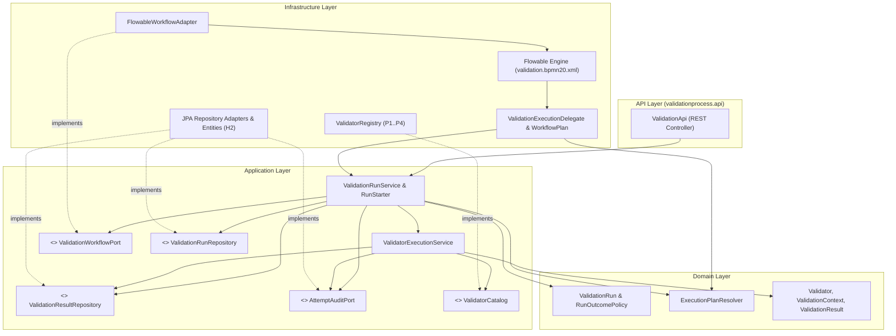

# Architecture — Validation Cockpit (Flowable Hybrid PoC)

## 1. Identified Features and Responsibilities

The codebase is organized **by feature** into three cohesive business capabilities under `poc`:

1. **`poc.validation` — Validator Execution, Domain Rules, Findings, Results & Attempt Auditing**
   - Defines the core validation domain model: [`Validator`](../src/main/java/poc/validation/domain/Validator.java), [`ValidationContext`](../src/main/java/poc/validation/domain/ValidationContext.java), [`ValidationFinding`](../src/main/java/poc/validation/domain/ValidationFinding.java), [`ValidationResult`](../src/main/java/poc/validation/domain/ValidationResult.java), and [`ExecutionAttempt`](../src/main/java/poc/validation/domain/ExecutionAttempt.java).
   - Orchestrates single-validator execution via [`ValidatorExecutionService`](../src/main/java/poc/validation/application/service/ValidatorExecutionService.java): enforces per-validator idempotency (`runId:validatorId`), records attempt start/completion through [`AttemptAuditPort`](../src/main/java/poc/validation/application/port/AttemptAuditPort.java), invokes the target [`Validator`](../src/main/java/poc/validation/domain/Validator.java) via [`ValidatorCatalog`](../src/main/java/poc/validation/application/port/ValidatorCatalog.java), and persists [`ValidationResult`](../src/main/java/poc/validation/domain/ValidationResult.java) via [`ValidationResultRepository`](../src/main/java/poc/validation/application/port/ValidationResultRepository.java).
   - Provides infrastructure adapters for the validator catalog ([`ValidatorRegistry`](../src/main/java/poc/validation/infrastructure/validator/ValidatorRegistry.java)) and JPA persistence ([`JpaValidationResultRepositoryAdapter`](../src/main/java/poc/validation/infrastructure/persistence/JpaValidationResultRepositoryAdapter.java), [`AttemptAuditAdapter`](../src/main/java/poc/validation/infrastructure/persistence/AttemptAuditAdapter.java)).

2. **`poc.executionplan` — Dependency Graph & Topological Stage Resolution**
   - Encapsulates validator dependency relationships (`P1 -> {P2, P3} -> P4`) in [`ExecutionPlanResolver`](../src/main/java/poc/executionplan/domain/ExecutionPlanResolver.java).
   - Computes the transitive downstream closure (`affected(Set<String>)`) for selective re-evaluation and resolves selected validators into topologically ordered execution stages (`resolve(Set<String>)` -> `[[P1], [P2, P3], [P4]]`).
   - Remains completely independent of Flowable, JPA, and Spring in the domain layer; wired via [`ExecutionPlanConfiguration`](../src/main/java/poc/executionplan/infrastructure/ExecutionPlanConfiguration.java).

3. **`poc.validationprocess` — Validation Process Lifecycle, Re-evaluation, Workflow Orchestration & REST API**
   - Owns the validation run lifecycle domain model ([`ValidationRun`](../src/main/java/poc/validationprocess/domain/ValidationRun.java), [`RunOutcomePolicy`](../src/main/java/poc/validationprocess/domain/RunOutcomePolicy.java), [`WorkflowStatus`](../src/main/java/poc/validationprocess/domain/WorkflowStatus.java), [`JobSnapshot`](../src/main/java/poc/validationprocess/domain/JobSnapshot.java), [`DuplicateRequestKeyException`](../src/main/java/poc/validationprocess/domain/DuplicateRequestKeyException.java)).
   - Orchestrates run creation, request-key idempotency, selective re-evaluation result reuse, lineage resolution, and dead-letter recovery in [`RunStarter`](../src/main/java/poc/validationprocess/application/service/RunStarter.java) and [`ValidationRunService`](../src/main/java/poc/validationprocess/application/service/ValidationRunService.java).
   - Isolates all Flowable engine interactions behind [`ValidationWorkflowPort`](../src/main/java/poc/validationprocess/application/port/ValidationWorkflowPort.java) and thin BPMN adapters in `infrastructure.flowable`.
   - Exposes the inbound HTTP API in [`ValidationApi`](../src/main/java/poc/validationprocess/api/ValidationApi.java).

---

## 2. Package Structure

```text
src/main/java/poc/
├── Application.java
│
├── validation/
│   ├── domain/
│   │   ├── ExecutionAttempt.java
│   │   ├── ValidationContext.java
│   │   ├── ValidationFinding.java
│   │   ├── ValidationResult.java
│   │   └── Validator.java
│   ├── application/
│   │   ├── port/
│   │   │   ├── AttemptAuditPort.java
│   │   │   ├── ValidationProbe.java
│   │   │   ├── ValidationResultRepository.java
│   │   │   └── ValidatorCatalog.java
│   │   └── service/
│   │       └── ValidatorExecutionService.java
│   └── infrastructure/
│       ├── persistence/
│       │   ├── AttemptAuditAdapter.java
│       │   ├── ExecutionAttemptJpaEntity.java
│       │   ├── JpaValidationResultRepositoryAdapter.java
│       │   ├── SpringDataAttemptRepository.java
│       │   ├── SpringDataValidationResultRepository.java
│       │   └── ValidationResultJpaEntity.java
│       └── validator/
│           ├── DefaultValidationProbe.java
│           └── ValidatorRegistry.java
│
├── executionplan/
│   ├── domain/
│   │   └── ExecutionPlanResolver.java
│   └── infrastructure/
│       └── ExecutionPlanConfiguration.java
│
└── validationprocess/
    ├── domain/
    │   ├── DuplicateRequestKeyException.java
    │   ├── JobSnapshot.java
    │   ├── RunOutcomePolicy.java
    │   ├── ValidationRun.java
    │   └── WorkflowStatus.java
    ├── application/
    │   ├── port/
    │   │   ├── ValidationRunRepository.java
    │   │   └── ValidationWorkflowPort.java
    │   └── service/
    │       ├── RunStarter.java
    │       └── ValidationRunService.java
    ├── infrastructure/
    │   ├── flowable/
    │   │   ├── FlowableWorkflowAdapter.java
    │   │   ├── ValidationExecutionDelegate.java
    │   │   └── WorkflowPlan.java
    │   └── persistence/
    │       ├── JpaValidationRunRepositoryAdapter.java
    │       ├── SpringDataValidationRunRepository.java
    │       └── ValidationRunJpaEntity.java
    └── api/
        └── ValidationApi.java
```

---

## 3. Hexagonal Dependency Boundaries

Dependencies point strictly inward (**`API / Infrastructure → Application → Domain`**) and acyclically across features (**`validationprocess → executionplan → validation`**):

- **Domain Layer (`..domain`)**:
  - Pure Java classes and records.
  - Zero dependencies on Flowable (`org.flowable.*`), Spring (`org.springframework.*`), JPA (`jakarta.persistence.*`), Jackson, or outer layers (`application`, `infrastructure`, `api`).
- **Application Layer (`..application.port`, `..application.service`)**:
  - Defines outbound ports (`ValidationWorkflowPort`, `ValidationRunRepository`, `ValidationResultRepository`, `AttemptAuditPort`, `ValidatorCatalog`, `ValidationProbe`) and application use-case services (`ValidationRunService`, `RunStarter`, `ValidatorExecutionService`).
  - Zero dependencies on Flowable APIs, JPA entities/repositories, web controllers, or `infrastructure` packages.
- **Infrastructure & API Layers (`..infrastructure.*`, `..api`)**:
  - Implement application ports using Flowable (`FlowableWorkflowAdapter`) and Spring Data JPA (`JpaValidationRunRepositoryAdapter`, `JpaValidationResultRepositoryAdapter`, `AttemptAuditAdapter`).
  - Only `poc.validationprocess.infrastructure.flowable` references `org.flowable.*`.
  - Only `..infrastructure.persistence` packages reference `jakarta.persistence.*` and `org.springframework.data.jpa.*`.
- **Automated Verification**:
  - [`ArchitectureTest`](../src/test/java/poc/ArchitectureTest.java) enforces all layer, framework, and cross-feature dependency rules on every build.

---

## 4. Flowable Integration and Interaction Diagram

Flowable integrates with the application in two directions:

1. **Outbound (Application → Flowable via `ValidationWorkflowPort`)**:
   - `RunStarter` and `ValidationRunService` invoke [`ValidationWorkflowPort`](../src/main/java/poc/validationprocess/application/port/ValidationWorkflowPort.java) to start a `"validation"` process instance, inspect runtime/historic state and jobs (`ASYNC`, `TIMER`, `DEAD_LETTER`), and requeue dead-letter jobs.
   - [`FlowableWorkflowAdapter`](../src/main/java/poc/validationprocess/infrastructure/flowable/FlowableWorkflowAdapter.java) implements this port using `RuntimeService`, `HistoryService`, and `ManagementService`.
2. **Inbound (Flowable BPMN → Application Use Cases via Thin Delegates)**:
   - [`WorkflowPlan`](../src/main/java/poc/validationprocess/infrastructure/flowable/WorkflowPlan.java) (`@Component("workflowPlan")`) adapts BPMN stage expressions (`resolve`, `advance`, `joined`) by reading the `selected` process variable, invoking [`ExecutionPlanResolver`](../src/main/java/poc/executionplan/domain/ExecutionPlanResolver.java), and setting stage loop variables (`stages`, `stageIndex`, `validators`, `more`).
   - [`ValidationExecutionDelegate`](../src/main/java/poc/validationprocess/infrastructure/flowable/ValidationExecutionDelegate.java) (`@Component("validationExecution")`) implements `JavaDelegate`, extracts `runId` and `validator` from `DelegateExecution`, and delegates immediately to `ValidationRunService.executeValidator(runId, validatorId)` → `ValidatorExecutionService.execute(...)`.



---

## 5. Responsibilities: BPMN Model vs. Java Services

| Concern | Owner | Mechanism |
|---|---|---|
| **Validator selection & dependency planning** | Java (`ExecutionPlanResolver`, `RunStarter`) | Topological stage resolution (`[[P1], [P2, P3], [P4]]`) and transitive dependent closure (`affected`) |
| **Stage barrier & parallel multi-instance execution** | BPMN (`validation.bpmn20.xml`) | Parallel multi-instance `<subProcess id="stage">` with non-exclusive async `validate` task and exclusive async `join` task |
| **Technical retries & dead-letter incidents** | BPMN / Flowable | Declarative `<flowable:failedJobRetryTimeCycle>R3/PT1S</flowable:failedJobRetryTimeCycle>` on `validate` |
| **Validator business rules & findings** | Java (`Validator`, `ValidatorRegistry`) | Pure domain evaluation returning `ValidationFinding` (`INVALID` outcome) without throwing technical exceptions |
| **Selective re-evaluation & result reuse** | Java (`RunStarter`, `ValidationRunService`) | Copies unaffected `VALID` upstream results (`reusedFromRun`, `attempt = 0`), forces re-evaluation of `INVALID` results and their dependents |
| **Request deduplication (`requestKey`)** | Java + Database (`ValidationRunJpaEntity`, `JpaValidationRunRepositoryAdapter`) | Unique constraint on `requestKey` with `saveAndFlush` before process start and `DuplicateRequestKeyException` recovery |
| **Attempt audit across rollbacks** | Java (`AttemptAuditAdapter`) | `Propagation.REQUIRES_NEW` persistence of `ExecutionAttempt` records |

---

## 6. Intentional Pragmatic Choices

To keep the PoC concise and avoid enterprise overengineering while maintaining strict dependency boundaries:

1. **Spring Stereotype & Transaction Annotations in Application Services**:
   - `RunStarter`, `ValidationRunService`, and `ValidatorExecutionService` use `@Service` and `@Transactional` directly rather than introducing a separate XML or `@Configuration` bean-wiring class for every application service. They remain 100% free of JPA, Flowable, and web dependencies and are directly unit-testable via constructor injection.
2. **Domain Read Projections in `ValidationRunService.RunView`**:
   - `ValidationRunService.RunView` exposes immutable domain objects (`ValidationResult`, `ExecutionAttempt`) directly in the read projection rather than duplicating identical DTO records in `api`, preserving the existing REST JSON contract with zero mapping boilerplate. JPA entities (`*JpaEntity`) are strictly confined to `infrastructure.persistence`.
3. **Direct Use of `ExecutionPlanResolver` as Domain Service**:
   - Because dependency resolution is deterministic, side-effect-free in-memory graph logic, `ExecutionPlanResolver` is a pure domain class wired via `ExecutionPlanConfiguration` without an artificial single-implementation interface.
