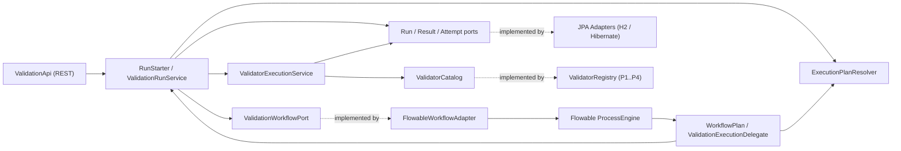

# Architecture – Validation Cockpit (Flowable C1 PoC)

This document describes the **current implemented architecture (C1)** of the Validation Cockpit Proof of Concept. In this hybrid design, Java owns validator selection, dependency planning, selective re-evaluation policy, idempotency, and business persistence, while Flowable OSS 8 serves as a durable reliability engine executing individual validators as asynchronous jobs.

For the architectural comparison between C0, C1, and C2, see [flowable-approach-comparison.md](flowable-approach-comparison.md). For setup, build, test, and scenario execution instructions, see the [README](../README.md).

---

## 1. Architectural Overview and Execution Model

The target Validation Cockpit accepts insurance applications across channels such as BiPRO `setOrder`, VBon/E-Antrag and e-mail. This PoC implements one REST adapter, one process key and four synthetic validators; channel routing, insurance payloads and external integrations are not implemented. The current flow operates as follows:

1. **Request Ingestion & Idempotency**:
   - Clients submit validation or selective re-evaluation requests via [`ValidationApi`](../src/main/java/poc/validationprocess/api/ValidationApi.java) with a unique logical `requestKey`.
   - [`RunStarter`](../src/main/java/poc/validationprocess/application/service/RunStarter.java) verifies input parameters, enforces global uniqueness on `ValidationRun.requestKey` via JPA and database constraint, and establishes a single Spring transaction.
   - Duplicate concurrent or sequential submissions under the same `requestKey` return the existing [`ValidationRun`](../src/main/java/poc/validationprocess/domain/ValidationRun.java) without starting duplicate workflow instances.

2. **Dynamic Stage Planning**:
   - The validation dependency DAG (`P1 -> {P2, P3} -> P4`) is resolved dynamically in Java by [`ExecutionPlanResolver`](../src/main/java/poc/executionplan/domain/ExecutionPlanResolver.java).
   - Java topologically sorts selected validators into sequential stages of mutually independent validators (for a full run: Stage 0 = `[P1]`, Stage 1 = `[P2, P3]`, Stage 2 = `[P4]`). `resolve(selected)` assumes omitted registered prerequisites are already done; it does not add prerequisites. Separately, `affected(requested)` computes downstream invalidation for re-evaluation.
   - The BPMN model [`validation.bpmn20.xml`](../src/main/resources/processes/validation.bpmn20.xml) contains zero hardcoded validator IDs; it dynamically loops over the stage list passed as process variables.

3. **Per-Validator Multi-Instance Execution**:
   - Flowable enters a parallel multi-instance subprocess `<subProcess id="stage">` over the current stage collection `${validators}`.
   - For each validator in the stage, Flowable creates a separate asynchronous execution running two sequential service tasks:
     - **`validate` (`flowable:async="true" flowable:exclusive="false"`)**: Executes [`ValidationExecutionDelegate`](../src/main/java/poc/validationprocess/infrastructure/flowable/ValidationExecutionDelegate.java), which delegates to [`ValidatorExecutionService`](../src/main/java/poc/validation/application/service/ValidatorExecutionService.java). This task records an independent attempt in [`AttemptAuditPort`](../src/main/java/poc/validation/application/port/AttemptAuditPort.java) (`REQUIRES_NEW`), invokes the domain [`Validator`](../src/main/java/poc/validation/domain/Validator.java), and flushes a [`ValidationResult`](../src/main/java/poc/validation/domain/ValidationResult.java) in the shared transaction. Retries are configured declaratively as `R3/PT1S`.
     - **`join` (`flowable:async="true" flowable:exclusive="true"`)**: A lightweight synchronization task that runs after `validate` succeeds. Its exclusive execution coordinates multi-instance completion updates after the validator transaction has committed. This isolates join retries from committed validator work; it does not establish immunity to all concurrency failures or a universal requirement for explicit BPMN parallel gateways.
   - Once all validator instances in the stage reach `itemEnd`, Flowable exits the subprocess, executes `${workflowPlan.advance(execution)}`, and loops to the next stage if `${more}` is true.

---

## 2. Package-by-Feature and Hexagonal Architecture

The codebase is organized by business feature (`poc.<feature>`), with hexagonal architecture (Ports & Adapters) applied within each feature:

```text
src/main/java/poc/
├── Application.java                                  # Spring Boot entry point
│
├── validation/                                       # Feature: Validator rules, execution & attempts
│   ├── domain/
│   │   ├── ExecutionAttempt.java                     # Plain Java domain model for attempts
│   │   ├── ValidationContext.java                    # Immutable context passed to Validator
│   │   ├── ValidationFinding.java                    # Domain finding value object
│   │   ├── ValidationResult.java                     # Domain result entity (outcome, finding, timestamps)
│   │   └── Validator.java                            # Domain validator contract
│   ├── application/
│   │   ├── port/
│   │   │   ├── AttemptAuditPort.java                 # Outbound port for attempt persistence
│   │   │   ├── ValidationProbe.java                  # Test instrumentation seam
│   │   │   ├── ValidationResultRepository.java       # Outbound port for result persistence
│   │   │   └── ValidatorCatalog.java                 # Outbound port for validator lookup
│   │   └── service/
│   │       └── ValidatorExecutionService.java        # Use case: executes validator & coordinates audit
│   └── infrastructure/
│       ├── persistence/                              # JPA entities, Spring Data repos & adapters
│       │   ├── AttemptAuditAdapter.java              # REQUIRES_NEW attempt audit adapter
│       │   ├── ExecutionAttemptJpaEntity.java
│       │   ├── JpaValidationResultRepositoryAdapter.java
│       │   ├── SpringDataAttemptRepository.java
│       │   ├── SpringDataValidationResultRepository.java
│       │   └── ValidationResultJpaEntity.java
│       └── validator/
│           ├── DefaultValidationProbe.java
│           └── ValidatorRegistry.java                # Concrete synthetic P1–P4 implementations
│
├── executionplan/                                    # Feature: Dependency graph & stage resolution
│   ├── domain/
│   │   └── ExecutionPlanResolver.java                # Pure Java topological sorter & closure resolver
│   └── infrastructure/
│       └── ExecutionPlanConfiguration.java           # Spring bean configuration for resolver
│
└── validationprocess/                                # Feature: Run lifecycle, orchestration & API
    ├── domain/
    │   ├── DuplicateRequestKeyException.java         # Domain exception on duplicate requestKey
    │   ├── JobSnapshot.java                          # Value object for engine job state
    │   ├── RunOutcomePolicy.java                     # Domain rules for run outcome derivation
    │   ├── ValidationRun.java                        # Plain Java domain model for validation runs
    │   └── WorkflowStatus.java                       # Value object for technical workflow state
    ├── application/
    │   ├── port/
    │   │   ├── ValidationRunRepository.java          # Outbound port for run persistence
    │   │   └── ValidationWorkflowPort.java           # Outbound port isolating Flowable engine
    │   └── service/
    │       ├── RunStarter.java                       # Use case: run creation & re-evaluation planning
    │       └── ValidationRunService.java             # Use case: start, retry, inspect & validator bridge
    ├── infrastructure/
    │   ├── flowable/                                 # Flowable adapters & BPMN delegates
    │   │   ├── FlowableWorkflowAdapter.java          # Implements ValidationWorkflowPort
    │   │   ├── ValidationExecutionDelegate.java      # Thin JavaDelegate bridge
    │   │   └── WorkflowPlan.java                     # BPMN expression adapter for plan variables
    │   └── persistence/
    │       ├── JpaValidationRunRepositoryAdapter.java
    │       ├── SpringDataValidationRunRepository.java
    │       └── ValidationRunJpaEntity.java
    └── api/
        └── ValidationApi.java                        # Inbound REST controller & request DTOs
```

### Dependency Rules and Hexagonal Boundaries

- **Inward Dependency Direction**: `API / Infrastructure -> Application -> Domain`.
- **Domain Layer Purity**: Classes in `*.domain` contain plain Java records and classes. They have zero imports or annotations from Spring, Flowable, JPA, or Jackson.
- **Application Layer Isolation**: Classes in `*.application` define use cases and ports. They have zero dependencies on Flowable engine APIs, JPA repositories, or HTTP web controllers.
- **Strict Framework Containment**:
  - `org.flowable.*` is referenced **exclusively** inside `poc.validationprocess.infrastructure.flowable`.
  - `jakarta.persistence.*` and `org.springframework.data.jpa.*` are referenced **exclusively** inside `*.infrastructure.persistence`.
- **Acyclic Feature Dependencies**: Cross-feature communication follows `validationprocess -> executionplan -> validation` and `validationprocess -> validation`. No feature imports another feature's infrastructure internals.
- **Automated Verification**: [`ArchitectureTest`](../src/test/java/poc/ArchitectureTest.java) executes 6 automated tests on every build enforcing layer purity, framework isolation, and feature boundaries.



---

## 3. Component Responsibilities

### Custom Java Process Orchestration

- **`ExecutionPlanResolver`**: Defines validator dependency relationships (`dependencies = Map.of("P1", Set.of(), "P2", Set.of("P1"), "P3", Set.of("P1"), "P4", Set.of("P2", "P3"))`). Computes topological stages for normal runs and calculates the transitive downstream closure (`affected(requested)`) for selective re-evaluations.
- **`RunStarter`**: Coordinates the transactional start boundary. Validates request arguments, enforces `requestKey` uniqueness, copies unaffected prior results with `reusedFromRun` provenance, and starts the Flowable process instance.
- **`ValidationRunService`**: Coordinates application-level operations:
  - Handles concurrent duplicate `requestKey` conflicts by catching `DuplicateRequestKeyException` and loading the committed winner.
  - Exposes `retryDeadLetters` by delegating to the workflow port.
  - Dynamically computes composite status in `inspect(id)` by querying Flowable job/runtime/history state, combining it with domain results, and calculating re-evaluation lineage.
- **`ValidatorExecutionService`**: Orchestrates single-validator execution: checks result existence to avoid repeating committed work (not an atomic execution claim), triggers attempt auditing, invokes the domain validator, flushes the domain result, and handles error propagation.

### Flowable Integration & BPMN Responsibilities

- **`FlowableWorkflowAdapter`**: Implements [`ValidationWorkflowPort`](../src/main/java/poc/validationprocess/application/port/ValidationWorkflowPort.java). Encapsulates all calls to Flowable `RuntimeService`, `ManagementService`, and `HistoryService`. Handles transient concurrency races (such as `FlowableObjectNotFoundException` during inspection when a process finishes concurrently).
- **`WorkflowPlan`**: Spring bean (`@Component("workflowPlan")`) invoked from BPMN expressions:
  - `${workflowPlan.resolve(execution)}`: Reads `selected` process variable, resolves stages, and initializes `stageIndex = 0`.
  - `${workflowPlan.advance(execution)}`: Increments `stageIndex` and updates `validators` and `more`.
  - `${workflowPlan.joined(execution)}`: No-op execution target for the exclusive join task.
- **`ValidationExecutionDelegate`**: Thin Spring bean (`@Component("validationExecution")`) implementing Flowable `JavaDelegate`. Extracts `runId` and `validator` from `DelegateExecution` and calls `ValidationRunService.executeValidator(runId, validatorId)`. Contains zero business logic.

---

## 4. State Ownership and Persistence Architecture

| State Category | Authoritative Owner | Persistence Mechanism | Access Path |
|---|---|---|---|
| **Active Activities & Tokens** | Flowable | `ACT_RU_EXECUTION` | `RuntimeService.getActiveActivityIds(processId)` |
| **Async Jobs, Timers & Retries** | Flowable | `ACT_RU_JOB`, `ACT_RU_TIMER_JOB`, `ACT_RU_DEADLETTER_JOB` | `ManagementService` job queries via `ValidationWorkflowPort` |
| **Workflow Progress & Variables** | Flowable | `ACT_RU_VARIABLE` (`stages`, `stageIndex`, `validators`, `more`) | Process variables on `DelegateExecution` |
| **Historic Process Completion** | Flowable | `ACT_HI_PROCINST` | `HistoryService.createHistoricProcessInstanceQuery()` |
| **Validation Run Aggregate** | Application Domain | `VALIDATION_RUN` table via JPA | [`ValidationRunRepository`](../src/main/java/poc/validationprocess/application/port/ValidationRunRepository.java) |
| **Business Results & Findings** | Application Domain | `VALIDATION_RESULT` table (`runId:validatorId`) | [`ValidationResultRepository`](../src/main/java/poc/validation/application/port/ValidationResultRepository.java) |
| **Per-Attempt Audit Trail** | Application Domain | `EXECUTION_ATTEMPT` table via JPA | [`AttemptAuditPort`](../src/main/java/poc/validation/application/port/AttemptAuditPort.java) (`REQUIRES_NEW`) |
| **Composite Cockpit Status** | Derived Dynamically | In-memory composite projection | [`ValidationRunService.inspect()`](../src/main/java/poc/validationprocess/application/service/ValidationRunService.java) |

### Transaction Boundaries and Consistency

Flowable and Spring Data JPA share a single Spring-managed `DataSource` (HikariCP) and `JpaTransactionManager`. No single database transaction spans the entire workflow; instead, execution proceeds through discrete transactional steps:

1. **Start Transaction (`RunStarter.start`)**: Inserts `ValidationRunJpaEntity`, flushes to enforce `requestKey` uniqueness, copies reused `ValidationResult` rows if re-evaluating, starts the Flowable process instance (executing `resolve` synchronously and creating stage 0 async jobs), and commits.
2. **Validator Job Transaction (`validate` task)**: Executed by Flowable async workers (`exclusive="false"`). Flushes `ValidationResultJpaEntity` and transitions execution to `join`. If an exception is thrown, both the flushed result and the Flowable transition roll back atomically.
3. **Stage Join Transaction (`join` task)**: Executed in a separate async job (`exclusive="true"`). Updates multi-instance completion variables and executes `advance` when the stage finishes.
4. **Attempt Audit (`AttemptAuditAdapter`)**: Uses `Propagation.REQUIRES_NEW` to commit attempt start and finish (including `RETURNED`) independently. Attempt evidence survives outer rollback, but a successful return does not mean the result transaction committed. Late failure can preserve `RETURNED` without a result; abrupt death can leave `STARTED`. Audit is not an atomic committed-result ledger.

The validator use case has no transaction annotation of its own; its result/engine atomicity depends on invocation inside the current Flowable/Spring job transaction. The existing post-flush rollback test verifies that integration, not all commit-failure windows. Request uniqueness does not establish exactly-once validator invocation or external business effects.

Flowable owns workflow progression; there is no second persisted application workflow status machine. Completed status currently depends on retained finished engine history: cleanup can yield `UNKNOWN`, and administrative deletion is not distinguished from successful completion. `RunOutcomePolicy` does not validate the expected result set before deriving `VALID`. These are current limitations, not promised production semantics. The inspected H2 schema had 30 `ACT_*`, two `FLW_*` and three domain tables; counts depend on engine configuration/version.

---

## 5. Retry, Error Handling, and Recovery Mechanisms

- **Declarative Technical Retries**: Configured in BPMN on `<serviceTask id="validate">` as `<flowable:failedJobRetryTimeCycle>R3/PT1S</flowable:failedJobRetryTimeCycle>`.
  - Failure 1: Decrements retries to 2, schedules `ACT_RU_TIMER_JOB` with 1-second delay, audit records `TECHNICAL_FAILURE` with error message.
  - Failure 2: Decrements retries to 1, schedules `ACT_RU_TIMER_JOB` with 1-second delay.
  - Failure 3: Moves job to `ACT_RU_DEADLETTER_JOB`, process state becomes `INCIDENT`.
- **Operator Incident Recovery**: An unauthenticated endpoint `POST /api/v1/validation-runs/{id}/dead-letter-retries` invokes `management.moveDeadLetterJobToExecutableJob(jobId, 3)`, returning the dead-letter job to executable status with a budget of 3 further executions; the tested scenario preserves completed upstream validators.
- **Business Findings vs Technical Failures**: A business finding returns a [`ValidationFinding`](../src/main/java/poc/validation/domain/ValidationFinding.java) without throwing an exception. The result is saved with `outcome = "INVALID"`, the job commits normally, no retries are triggered, and downstream validators execute.
- **Restart Recovery**:
  - Graceful restart with pending unacquired jobs resumes automatically when Flowable's async executor starts up.
  - Graceful mid-workflow restart is verified by `twoProcessRestartResumesMidWorkflowAfterPartialStageAndFailure`: the child completes P1/P2 and fails P3 attempt 1, then shuts down its executor and closes its context; the parent resumes against the same file database, retains committed results/audit and completes P3 attempt 2 and P4. This is not abrupt termination or concurrent multi-node evidence.
  - Flowable 8.0.0 defaults async job locks to one hour and expired-job reset polling to one minute; current properties do not override these. Abrupt recovery depends on expiry, reset/acquisition scheduling and database availability and is untested. See the [version-tagged defaults](https://github.com/flowable/flowable-engine/blob/flowable-8.0.0/modules/flowable-job-service/src/main/java/org/flowable/job/service/impl/asyncexecutor/AsyncJobExecutorConfiguration.java).

All runtime technical failures currently use the same retry path; transient/permanent classification is not implemented. Async boundaries are persisted wait points, although there are no human tasks or external business waits. Existing runs invoke the currently deployed validator registry, not a pinned Java implementation. Re-evaluation completeness uses the current catalog size; deployment/input/rule compatibility remains unverified. For the evidence gaps and proposed tests, see [production resilience](flowable-approach-comparison.md#5-production-resilience-demonstrated-guarantees-and-outstanding-validation) and [test strategy](flowable-approach-comparison.md#7-recommended-automated-resilience-test-strategy).

---

## 6. Requirements-to-Implementation Traceability Matrix

This matrix documents the verification status of all functional requirements (FR-01 through FR-08) and architectural requirements (AR-01 through AR-06), incorporating evidence from tests and codebase inspection.

| ID | Requirement & Description | Implementation Mechanism | Status | Evidence & Verification | Limitations & Remaining Gaps |
|---|---|---|---|---|---|
| **FR-01** | **Dynamic Execution Planning**: Calculate validator execution stages dynamically in Java without hardcoded BPMN paths. | [`ExecutionPlanResolver`](../src/main/java/poc/executionplan/domain/ExecutionPlanResolver.java) topologically sorts validators into stages `[[P1], [P2, P3], [P4]]`. Injected into process via [`WorkflowPlan.resolve`](../src/main/java/poc/validationprocess/infrastructure/flowable/WorkflowPlan.java). | **Implemented** | `ExecutionPlanResolverUnitTest#resolvesFullPlanIntoExpectedTopologicalStages`, `ValidationIntegrationTest#normalOrderingAndPersistence`. | `dependencies` map is hardcoded in Java; dynamic configuration per insurance product is not yet implemented. |
| **FR-02** | **True Parallel Validator Execution**: Independent validators in the same stage must execute concurrently across worker threads. | BPMN `<serviceTask id="validate">` configured with `async="true" exclusive="false"`. Spring `ThreadPoolTaskExecutor` pool size = 4. | **Implemented** | `ValidationIntegrationTest#actualParallelJobs`: P2 and P3 meet at a two-party `CyclicBarrier` on two distinct thread names simultaneously. | The current design uses two jobs per successful validator (`validate` + `join`); concurrent-node behavior is untested. |
| **FR-03** | **Independent Technical Retries & Incidents**: A failing validator must retry independently without repeating completed peers or prior stages. Exhausted retries become incidents. | Flowable `failedJobRetryTimeCycle` (`R3/PT1S`), `ACT_RU_TIMER_JOB`, `ACT_RU_DEADLETTER_JOB`, and `AttemptAuditAdapter` (`REQUIRES_NEW`). | **Implemented** | `ValidationIntegrationTest#technicalRetryIsIndividual`, `ValidationIntegrationTest#exhaustedRetriesBecomeDeadLetter`. | The custom `ExecutionAttempt` table preserves attempt messages independently of transient engine job rows. Permanent technical failure classification is absent. |
| **FR-04** | **Persistent Execution & Recovery**: Workflow execution state must survive application restarts and resume pending work. | Shared H2 file database, Flowable async job tables, and engine job acquisition scanner on restart. | **Implemented** (for graceful restart) | `ValidationIntegrationTest#restartResumesCommittedPendingJob`, `ValidationIntegrationTest#twoProcessRestartResumesMidWorkflowAfterPartialStageAndFailure`. | Abrupt termination/abandoned-lock recovery is untested. Flowable 8.0.0 defaults: one-hour async lock, one-minute expired-job reset polling, plus acquisition/queue delay. |
| **FR-05** | **Duplicate Request Handling (Idempotency)**: Submitting identical `requestKey` must return the existing run without duplicate process creation. | `@UniqueConstraint(columnNames = "requestKey")` on `ValidationRunJpaEntity`, `saveAndFlush` before process start, and `DuplicateRequestKeyException` recovery. | **Implemented** | `ValidationIntegrationTest#concurrentDuplicateRequests`: 2 concurrent threads get same run ID; `HistoryService` confirms exactly 1 process instance. | Changed payload/parent under an existing key returns the original run after basic parameter checks. No fingerprint comparison, multi-node proof or exactly-once invocation guarantee. |
| **FR-06** | **Selective Re-evaluation**: Re-evaluating a subset of validators must re-run only requested and dependent validators, copying valid prior results with provenance. | [`RunStarter.start`](../src/main/java/poc/validationprocess/application/service/RunStarter.java) calculates transitive closure (`plans.affected`), forces re-evaluation of prior invalid results, copies unaffected results (`reusedFromRun`, `attempt=0`). | **Implemented** | `ValidationIntegrationTest#selectiveReevaluation`, `ValidationRunServiceUnitTest#selectiveReevaluationIncludesPriorInvalidValidatorsAndCopiesValidUpstreamResults`. | Re-evaluation creates a new correlated `ValidationRun`; active process tokens are never rewound. The starter requires an inactive parent and a result count matching the current catalog; it does not explicitly check successful historic completion. |
| **FR-07** | **Business vs. Technical Failures**: Business rule findings produce `INVALID` outcome without technical retry; technical exceptions trigger retries. | [`Validator.validate`](../src/main/java/poc/validation/domain/Validator.java) returns [`ValidationFinding`](../src/main/java/poc/validation/domain/ValidationFinding.java) on rule failure. Throws `RuntimeException` on technical failure. | **Implemented** | `ValidationIntegrationTest#businessFindingDoesNotRetryOrBlockStages`, `ValidatorExecutionServiceUnitTest#recordsBusinessFindingAsInvalidOutcomeWithoutThrowing`. | Downstream validators execute even when upstream results are `INVALID` (dependencies mean "completed", not "valid"). Business skipping rules not modeled. |
| **FR-08** | **REST API**: Manage validation runs, selective re-evaluations, dead-letter retries, and inspection over HTTP. | [`ValidationApi`](../src/main/java/poc/validationprocess/api/ValidationApi.java) with endpoints `POST /`, `GET /{id}`, `POST /{id}/re-evaluations`, `POST /{id}/dead-letter-retries`. | **Implemented** | `ValidationIntegrationTest#restApiStartsInspectsAndReevaluates`: verifies `200`, `400` (bad payload), `404` (unknown ID), findings, and lineage. | Dead-letter retry endpoint is unauthenticated; suitable for PoC evaluation only. |
| **AR-01** | **Per-Validator Execution Granularity**: Flowable schedules each validator individually, not as a single monolithic Java block. | BPMN multi-instance subprocess spawns individual `validate` async service task per validator. | **Implemented** | `ValidationIntegrationTest` all 11 tests; inspectable in `ACT_RU_JOB` and `ACT_HI_ACTINST`. | Multi-instance subprocess adds engine overhead and job table churn. |
| **AR-02** | **State Ownership**: Flowable owns technical progress and jobs; application owns business results and lineage. | `VALIDATION_RUN`, `VALIDATION_RESULT`, and `EXECUTION_ATTEMPT` tables. Status derived dynamically in `inspect()`. | **Implemented** | `ValidationIntegrationTest#normalOrderingAndPersistence`. Inspect handles `FlowableObjectNotFoundException` race. | Inspection combines multiple engine/domain queries, increasing with lineage; not an atomic snapshot. Completion depends on retained history; cancellation/completeness semantics need work. |
| **AR-03** | **Transaction Boundaries**: Shared transaction manager; domain results and engine step commit or roll back together. | Shared `JpaTransactionManager` (`PlatformTransactionManager`) between Spring Data JPA and Flowable. | **Implemented** | `ValidationIntegrationTest#resultAndEngineJobRollbackTogether`: post-flush exception rolls back JPA result and engine step atomically. | Independent audit needs additional connections; 2W plus buffer is a heuristic, not a minimum. RETURNED can outlive outer rollback. Late commit failures and direct use outside engine transactions are untested. |
| **AR-04** | **Framework vs. Custom Infrastructure**: Eliminate custom job queues, retry schedulers, stage latches, and recovery scanners. | Flowable provides `ACT_RU_JOB`, `failedJobRetryTimeCycle`, multi-instance barrier, and startup acquisition. | **Implemented** | No application acquisition/retry/recovery loops are implemented; real engine tests demonstrate retries and graceful resume. Savings against unbuilt C0 remain unmeasured. | Inspected schema: 30 `ACT_*` + 2 `FLW_*` engine tables; MyBatis/JPA integration and two-job subprocess pattern. |
| **AR-05** | **Maintainability & Clean Architecture**: Package-by-feature, hexagonal layers, decoupled validator interface, domain purity. | Packages `poc.validation`, `poc.executionplan`, `poc.validationprocess`; pure domain records; thin adapters. | **Implemented** | [`ArchitectureTest`](../src/test/java/poc/ArchitectureTest.java) passes 6 checks enforcing layer purity and dependency rules. | `ValidationRunService.RunView` directly exposes domain models (`ValidationResult`, `ExecutionAttempt`) in read projection. |
| **AR-06** | **Technology Compatibility**: Tested Java 17/H2 stack; production database portability requires validation. | Java 17, Boot 4.0.2, Spring 7.0.3, Hibernate 7.2.1, Flowable 8.0.0, H2 2.4.240, JUnit 5.13.4. | **Implemented** | Verified from packaged jar `BOOT-INF/lib/` and clean test execution. | SQL Server is untested. Evaluate isolation, driver, migrations and locking; enabling both snapshot options is not an unconditional Flowable requirement. |

---

## 7. Relevant Architectural Decisions and Constraints

1. **The Two-Step Subprocess Pattern (`validate` + `join`)**:
   - *Rationale*: Concurrent multi-instance completion can contend on parent execution state. Putting all validator jobs under exclusive execution would serialize them. The current pattern separates parallel validation from completion coordination; the suite verifies this pattern, not the necessity of it in every model.
   - *Decision*: Split each item into non-exclusive async `validate` and exclusive async `join`. A join retry does not re-enter the already committed validation task. This does not preclude re-execution after an uncommitted validate failure or expired ownership.
2. **`REQUIRES_NEW` for Attempt Auditing**:
   - *Rationale*: Transient job rows are not a complete retained attempt ledger. Synthetic attempt counters and technical failure evidence must survive outer rollback.
   - *Decision*: [`AttemptAuditAdapter`](../src/main/java/poc/validation/infrastructure/persistence/AttemptAuditAdapter.java) commits attempt starts and finishes in `Propagation.REQUIRES_NEW`. Additional connections can cause starvation; 2 × workers + buffer is a sizing heuristic, not a universal requirement. Include other borrowers and measure saturation. RETURNED records return, not outer commit.
3. **Derived Status vs Persisted Workflow Enum**:
   - *Decision*: `ValidationRun` has no `status` column. Run state (`RUNNING`, `INCIDENT`, `COMPLETED`) is derived dynamically from Flowable runtime and history queries, avoiding competing state machines.
4. **Clean Domain Records and Methods**:
   - *Decision*: Domain entities are immutable classes/records. Domain methods use domain-specific naming (e.g., [`ValidationResult.hasValidOutcome()`](../src/main/java/poc/validation/domain/ValidationResult.java)) to prevent Jackson from synthesizing unexpected JSON properties in REST responses.
